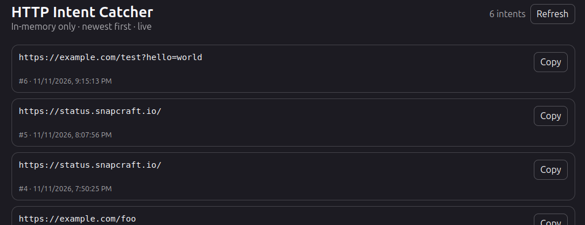
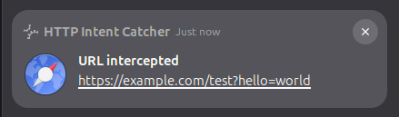

# HTTP Intent Catcher

A tiny, dependency-free Python app for Linux desktops that registers itself as the default `http` and `https` URL scheme handler.

**Why?**
Because if you want to have completely isolated profiles with their own navigation history, the protocol handler comes to ruin your life faster than light.
Apps open links as they please without asking, filling your session with unwanted cookies and trackers in the last profile you opened. Not any more. My computer, my rules.

When another desktop application asks Linux to open an HTTP(S) URL, the catcher:

1. sends the URL to a local process;
2. stores it **only in RAM**;
3. shows a GNOME/libnotify pop-up through `notify-send`;
4. exposes a web UI ordered newest to oldest;
5. exposes the latest URL through a JSON API.

It does **not** inspect network traffic and does not intercept navigation inside an already-running browser.





## Requirements

- Python 3.10+
- `xdg-mime` (`xdg-utils`) for handler registration
- `notify-send` (`libnotify-bin`) for GNOME notifications

On Ubuntu:

```bash
sudo apt install xdg-utils libnotify-bin
```

## Install

```bash
chmod +x ./http-intent-catcher
./http-intent-catcher install
```

The installer copies the app to `~/.local/bin/http-intent-catcher`, creates the required desktop entry, and makes it the default handler for both `http` and `https`.

There is no app config file. The default server is `127.0.0.1:34567`.

The server starts automatically the first time a URL is intercepted. You can also start it explicitly:

```bash
http-intent-catcher serve
```

## Use

Web UI:

```text
http://127.0.0.1:34567/
```

Latest intent:

```bash
curl http://127.0.0.1:34567/api/last
```

All intents, newest first:

```bash
curl http://127.0.0.1:34567/api/intents
```

Test interception without changing apps:

```bash
xdg-open 'https://example.com/test?hello=world'
```

You can also inject a URL directly for testing:

```bash
http-intent-catcher capture 'https://example.com/'
```

## API

### `GET /api/last`

Returns the newest captured item, or JSON `null` if there are no items yet.

Example:

```json
{"id":3,"url":"https://example.com/","captured_at":"2026-11-11T20:00:00.000000Z"}
```

### `GET /api/intents`

Returns all currently held items, newest first.

### `POST /api/intents`

Internal ingestion endpoint. Requires `Content-Type: application/json` and:

```json
{"url":"https://example.com/"}
```

Only `http://` and `https://` URLs are accepted.

## Uninstall

```bash
http-intent-catcher uninstall
```

The app intentionally does not store the previous browser selection, because that would violate the no-persistent-config goal. After uninstalling, select your browser again in GNOME Settings or use `xdg-settings set default-web-browser ...`.

## Notes

- All captured intents disappear when the server process exits.
- The UI deliberately provides **Copy**, not an ordinary clickable URL, because clicking an HTTP link would simply be intercepted again while this app is your default handler.
- By default the HTTP server listens only on loopback, not your LAN.
